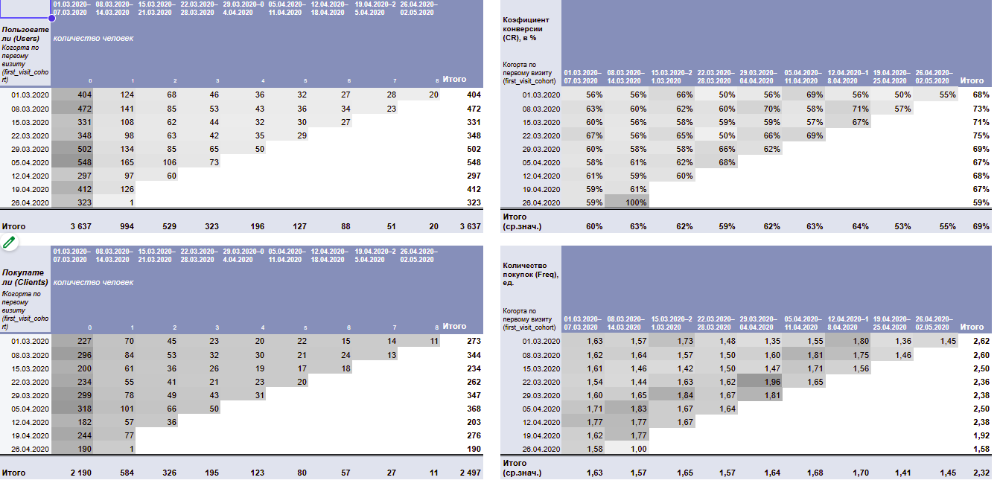
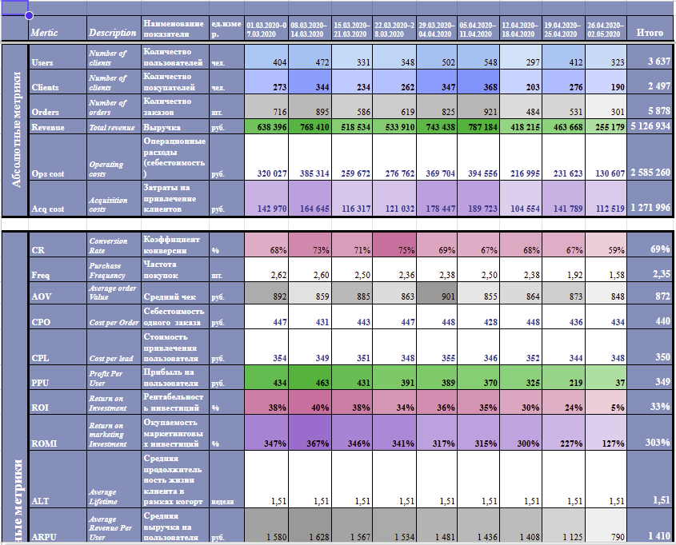
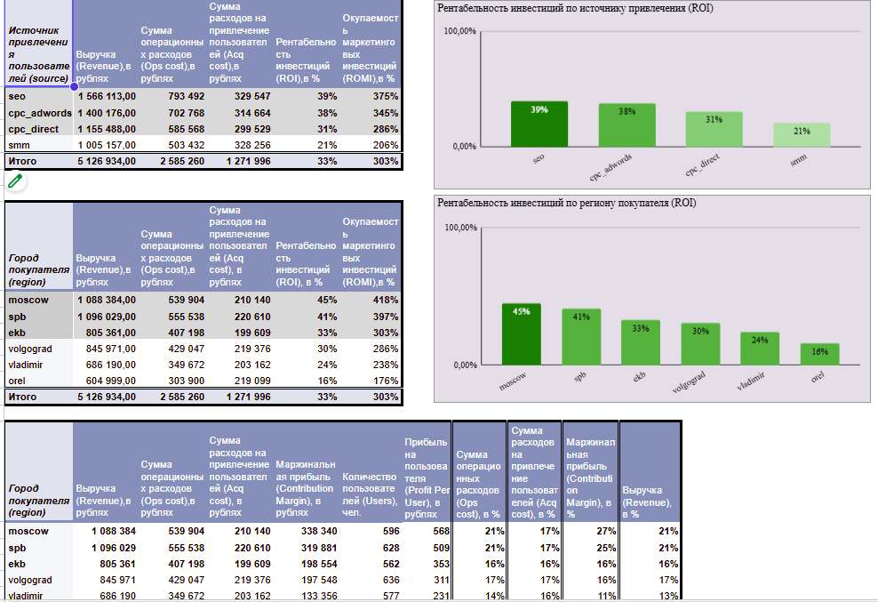
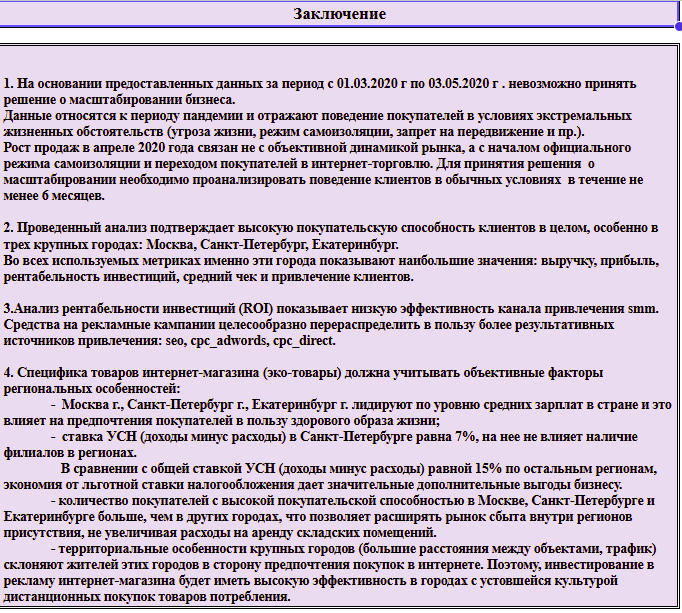

# Анализ юнит-экономики и перспектив масштабирования бизнеса

## О проекте

Исследование деятельности компании из Новосибирска, специализирующейся на онлайн-продаже экологических товаров для дома.

Цель проекта — оценить экономическую эффективность бизнеса, проанализировать поведение покупателей, определить результативность каналов привлечения и исследовать возможности масштабирования компании.

**Период анализа:** 1 марта — 3 мая 2020 года.

**Инструмент:** Google Sheets. Для публикации также подготовлена версия в формате Excel (.xlsx).

## Задачи исследования

- Рассчитать недельную возвращаемость покупателей по когортам.
- Исследовать конверсию пользователей в покупателей.
- Рассчитать показатели юнит-экономики и финансовой эффективности.
- Оценить окупаемость затрат на привлечение клиентов.
- Сравнить эффективность маркетинговых каналов.
- Проанализировать рентабельность бизнеса в разных городах.
- Сформулировать рекомендации относительно дальнейшего развития компании.

## Использованные метрики

**Клиентская аналитика:**
- Retention Rate — возвращаемость покупателей.
- CR — коэффициент конверсии.
- Freq — частота покупок.
- AOV — средний чек.
- ALT — время жизни клиента.

**Юнит-экономика и финансы:**
- Revenue — выручка.
- Ops Cost — операционные расходы.
- Acquisition Cost — затраты на привлечение.
- Contribution Margin — маржинальная прибыль.
- CPO — стоимость заказа.
- CPL — стоимость привлечения пользователя.
- PPU — прибыль на пользователя.
- ROI и ROMI — показатели рентабельности инвестиций.

## 1. Когортный анализ

Покупатели сгруппированы по неделям совершения первой покупки.

Для каждой когорты исследована динамика повторных покупок в последующие недели.

Когортный анализ позволяет выявить различия в поведении клиентов, оценить возвращаемость покупателей и исследовать устойчивость клиентской базы.

## 2. Расчёт юнит-экономики

В рамках исследования рассчитаны основные показатели деятельности компании.

По данным за исследуемый период:

| Показатель | Значение |
|---|---:|
| Количество пользователей | 3 637 |
| Количество покупателей | 2 497 |
| Количество заказов | 5 878 |
| Выручка | 5,13 млн ₽ |
| Операционные расходы | 2,59 млн ₽ |
| Затраты на привлечение | 1,27 млн ₽ |
| Средний чек | 872 ₽ |
| Конверсия в покупку | 69% |

Расчёты позволяют оценить соотношение доходов и расходов, эффективность привлечения покупателей и экономические результаты деятельности.

## 3. Эффективность маркетинговых каналов и регионов

Проведено сравнение финансовых результатов по источникам привлечения пользователей и городам.

### ROI по маркетинговым каналам

| Источник | ROI |
|---|---:|
| SEO | 39% |
| CPC AdWords | 38% |
| CPC Direct | 31% |
| SMM | 21% |

В исследуемом периоде наибольшую рентабельность показали SEO и CPC AdWords, наименьшую — SMM.

### ROI по городам

| Город | ROI |
|---|---:|
| Москва | 45% |
| Санкт-Петербург | 41% |
| Екатеринбург | 33% |
| Волгоград | 30% |
| Владимир | 24% |
| Орёл | 16% |

Москва, Санкт-Петербург и Екатеринбург демонстрируют наиболее высокую рентабельность среди рассматриваемых городов.

## 4. Основные выводы

### Ограничения исследования

Данные охватывают март — начало мая 2020 года, то есть период введения ограничений, связанных с пандемией COVID-19.

Изменение покупательского поведения в условиях самоизоляции могло существенно повлиять на показатели интернет-торговли.

Поэтому полученные результаты нельзя автоматически распространять на обычные рыночные условия.

### Региональные различия

Наиболее высокие показатели рентабельности инвестиций наблюдаются в Москве, Санкт-Петербурге и Екатеринбурге.

При оценке перспектив регионального развития необходимо дополнительно учитывать покупательную способность населения, структуру спроса, логистику и особенности ведения бизнеса.

### Маркетинговая эффективность

Канал SMM продемонстрировал наименьшую рентабельность среди исследованных источников привлечения.

Целесообразно дополнительно оценить возможность перераспределения маркетингового бюджета в пользу более эффективных каналов с учётом объёмов привлечения и потенциальной отдачи от дополнительных вложений.

### Решение о масштабировании

**По результатам исследования не рекомендовано принимать окончательное решение о масштабировании бизнеса на основании имеющегося периода наблюдений.**

Для более обоснованного решения необходимо изучить поведение покупателей в обычных рыночных условиях на протяжении как минимум шести месяцев, а также оценить устойчивость финансовых показателей.

## Структура проекта

Исходная рабочая книга содержит:

- Постановку задачи и цели исследования.
- Оглавление с навигацией.
- Аналитическое заключение.
- Диаграммы бизнес-показателей.
- Когортные таблицы возвращаемости.
- Расчёты конверсии и юнит-экономики.
- Расчёты времени жизни клиента (ALT).
- Анализ ROI и ROMI по регионам и источникам привлечения.
- Исходные и вспомогательные данные.

## Файлы проекта

- `Business_Unit_Economics_Analysis.xlsx` — расчётная модель и результаты исследования.
- `screenshots/` — изображения основных расчётов, диаграмм и выводов.
- `README.md` — описание проекта.

Исходное исследование выполнено в Google Sheets. Для просмотра расчётов доступна версия Excel. Некоторые диаграммы могут отличаться по оформлению от оригинала Google Sheets.

## Автор

**Ирина Курдюкова**

Финансовый специалист с опытом бухгалтерского учёта, финансового анализа и контроля. Развиваю компетенции в анализе данных, SQL, Python, Pandas и Power BI.
